# Comparison of Fuzzy Logic and PID Control in an Anti-Lock Braking System (ABS)

A comprehensive MATLAB/Simulink quarter-car simulation comparing a **Fuzzy Logic Controller (FLC)** and a **Proportional-Integral-Derivative (PID) Controller** for an Anti-lock Braking System (ABS) under **Dry**, **Wet**, and **Icy** road conditions.

---

## Project Overview

Anti-lock Braking Systems (ABS) are crucial safety mechanisms in modern automobiles designed to prevent wheel lock-up during hard braking. By dynamically modulating brake line pressure, an ABS ensures the tire-road interface operates near the optimal tire slip ratio ($\lambda$), thereby maximizing the friction coefficient ($\mu$) and maintaining vehicle steerability while minimizing stopping distance.

This repository provides a complete simulation environment comparing:
1. **PID Control**: A standard linear controller tuned via classical methods.
2. **Fuzzy Logic Control (Mamdani FLC)**: A rule-based controller capable of adapting to non-linear tire-road interactions and surface uncertainties.

---

## Repository Structure

```text
├── ABS Fuzzy VS PID Report.docx  # Full project report (MECE404 End of Semester Project)
├── ABS.fis                        # MATLAB Fuzzy Logic Controller file (Mamdani FIS)
├── final_abs_code.m               # MATLAB setup script (parameters & mu-slip curves)
├── absbrake.slx                   # Main Simulink model file
├── absbrake/                      # Simulink model project directory source files
├── .gitignore                     # Git ignore file for MATLAB/Simulink temporary files
└── README.md                      # Project documentation and guide
```

---
##  System Architecture
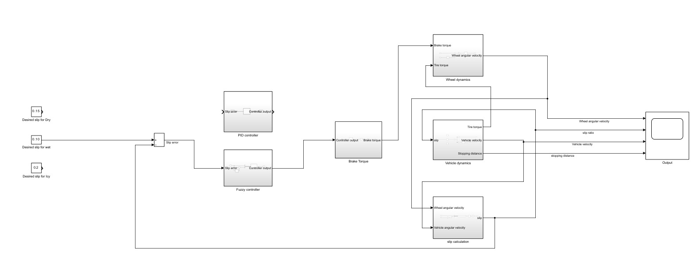


## Mathematical & System Model

The system utilizes a **quarter-car vehicle model** with dynamic equations governing vehicle translation and wheel rotation:

### 1. System Parameters

| Parameter | Description | Value | Unit |
| :--- | :--- | :--- | :--- |
| $g$ | Acceleration due to gravity | $9.81$ | $\text{m/s}^2$ |
| $m$ | Quarter-car mass | $400$ | $\text{kg}$ |
| $R_r$ | Wheel radius | $0.3$ | $\text{m}$ |
| $v_0$ | Initial vehicle velocity | $40$ ($\approx 144\text{ km/h}$) | $\text{m/s}$ |
| $J$ | Wheel rotational moment of inertia | $5.0$ | $\text{kg}\cdot\text{m}^2$ |
| $K_f$ | Brake torque gain over pressure | $1.0$ | $\text{N}\cdot\text{m}/\text{Pa}$ |

### 2. Governing Equations

* **Vehicle Dynamics (Newton's 2nd Law)**:
  $$m \frac{dv}{dt} = -F_x$$
  where $F_x = \mu(\lambda) \cdot F_z$ and normal force $F_z = m \cdot g$.

* **Wheel Rotational Dynamics**:
  $$J \frac{d\omega}{dt} = R_r F_x - T_b$$
  where $T_b$ is the braking torque applied to the wheel.

* **Slip Ratio ($\lambda$) Calculation**:
  $$\lambda = \frac{v - \omega R_r}{\max(v, \epsilon)}, \quad (\epsilon \ll 0.1)$$

* **Actuator Dynamics (Brake Pressure to Torque)**:
  Brake pressure output from the controller is transformed into brake torque $T_b$ via a first-order transfer function followed by saturation limits.

### 3. Tire-Road Friction Coefficient ($\mu-\lambda$ Curves)

---

## Tire-Road Friction Coefficient (μ–λ Curves)

The relationship between slip ratio (λ) and friction coefficient (μ) is nonlinear and varies with road conditions.

### Dry Asphalt
Peak friction coefficient: μ ≈ 0.90  
Target slip ratio: λ = 0.15

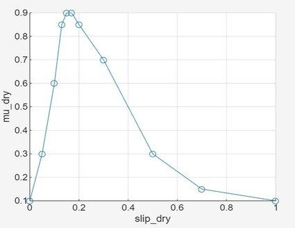

### Wet Asphalt
Peak friction coefficient: μ ≈ 0.70  
Target slip ratio: λ = 0.10

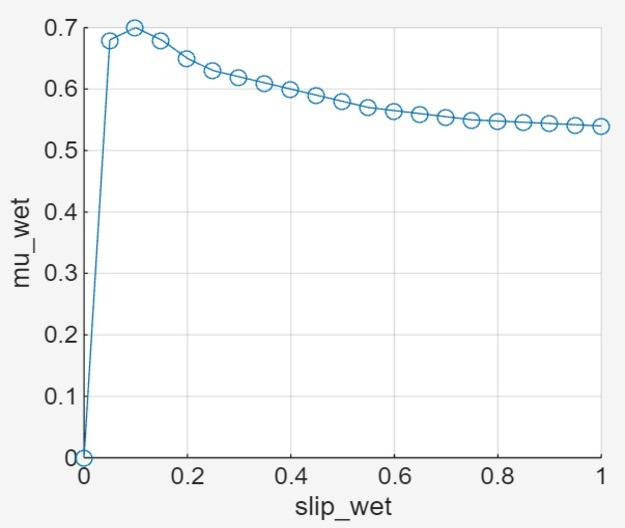

### Icy Asphalt
Peak friction coefficient: μ ≈ 0.10  
Target slip ratio: λ = 0.20

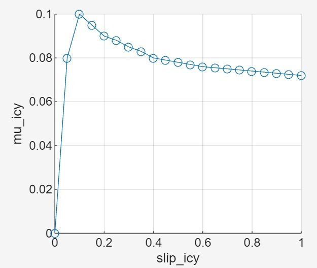

---

## Controller Specifications

### 1. PID Controller
* **Input**: Slip error $e(t) = \lambda_{target} - \lambda(t)$.
* **Output**: Modulated brake pressure signal.
* **Tuned Gains**:
  * $K_p = 20$
  * $K_i = 18$
  * $K_d = 2$

### 2. Fuzzy Logic Controller (FLC)
* **Inference System**: Mamdani-type (`ABS.fis`).
* **Defuzzification**: Centroid.
* **Inputs**:
  1. `error` ($e \in [-1, 1]$): Difference between desired and actual slip.
  2. `error_change` ($\dot{e} \in [-50, 50]$): Rate of change of slip error.
* **Output**:
  1. `pressure` ($\Delta P \in [-10, 10]$): Brake pressure adjustment rate.

#### Linguistic Sets & Membership Functions
* **Inputs (`error`)**: `NL` (Negative Large), `NS` (Negative Small), `ZE` (Zero), `PS` (Positive Small), `PL` (Positive Large).
* **Inputs (`error_change`)**: `NL`, `ZE`, `PL`.
* **Output (`pressure`)**:
  * `DPL`: Decrease Pressure Large (Quickly release brake)
  * `DPS`: Decrease Pressure Small (Slowly release brake)
  * `HOLD`: Hold current pressure
  * `IPS`: Increase Pressure Small (Slowly apply brake)
  * `IPL`: Increase Pressure Large (Quickly apply brake)

#### Rule Base Matrix

| `error` \ `error_change` | NL | ZE | PL |
| :---: | :---: | :---: | :---: |
| **NL** | DPL | DPS | HOLD |
| **NS** | DPL | DPS | HOLD |
| **ZE** | DPS | HOLD | IPS |
| **PS** | HOLD | IPS | IPL |
| **PL** | HOLD | IPS | IPL |

---

## 🚀 How to Run the Simulation

### Prerequisites
* **MATLAB** (R2020a or newer recommended)
* **Simulink**
* **Fuzzy Logic Toolbox**

### Step-by-Step Instructions

1. **Clone the Repository**:
   ```bash
   git clone https://github.com/your-username/flc-vs-pid-abs-control.git
   cd flc-vs-pid-abs-control
   ```

2. **Open MATLAB**:
   Launch MATLAB and set your current working directory to the repository folder:
   ```matlab
   cd('/path/to/flc-vs-pid-abs-control')
   ```

3. **Run the Initialization Script**:
   Execute `final_abs_code.m` in the MATLAB Command Window to load vehicle constants and lookup tables ($\mu$-slip data for dry, wet, and icy roads) into the workspace:
   ```matlab
   run('final_abs_code.m')
   ```

4. **Load the Fuzzy Controller**:
   Load the Mamdani FIS into the workspace:
   ```matlab
   fis = readfis('ABS.fis');
   ```

5. **Open the Simulink Model**:
   Open the Simulink model file:
   ```matlab
   open_system('absbrake.slx')
   ```

6. **Configure and Run the Simulation**:
   - Set the surface condition in the model (select lookup table for Dry, Wet, or Icy asphalt).
   - Set the corresponding target slip ratio ($\lambda_{dry}=0.15$, $\lambda_{wet}=0.10$, $\lambda_{icy}=0.20$).
   - Set the simulation stop time:
     - **Dry Road**: 20 seconds
     - **Wet Road**: 26 seconds
     - **Icy Road**: 190 seconds
   - Click **Run** in Simulink.

7. **Analyze Results**:
   Inspect Scope plots for **Wheel Speed**, **Vehicle Speed**, **Slip Ratio**, and **Stopping Distance**.

---

## 📊 Results & Comparison

| Surface Condition | Target Slip ($\lambda$) | PID Slip Tracking | Fuzzy Slip Tracking | Wheel Speed Stability | Stopping Distance |
| :--- | :---: | :---: | :---: | :--- | :--- |
| **Dry Asphalt** | `0.15` | High oscillation & overshoot | Exceptional tracking, minimal deviation | PID shows high-frequency chattering; FLC is smooth | FLC stops shorter |
| **Wet Asphalt** | `0.10` | Large oscillations initial phase | Stable tracking with low overshoot | FLC shows reduced high-frequency chatter | FLC stops shorter |
| **Icy Asphalt** | `0.20` | Extreme oscillations | Reduced oscillation amplitude | Both exhibit oscillations, FLC less aggressive | Similar performance |

### Simulation Results

The plots below are taken from Simulink. Each road condition compares the Fuzzy Logic Controller (FLC) and PID controller for vehicle speed, wheel speed, slip ratio, and stopping distance.

#### Dry Asphalt

| Vehicle Speed | Wheel Speed |
| :---: | :---: |
| 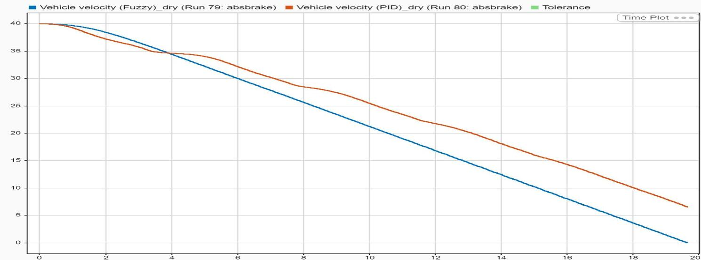 | 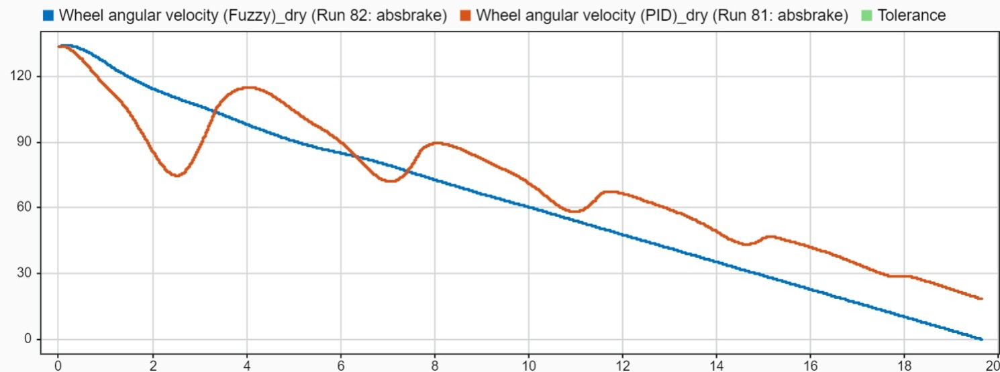 |

| Slip Ratio | Stopping Distance |
| :---: | :---: |
| 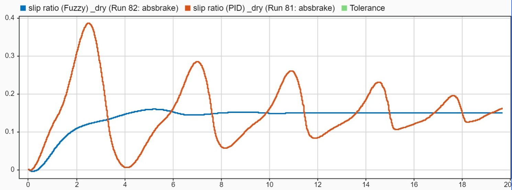 | 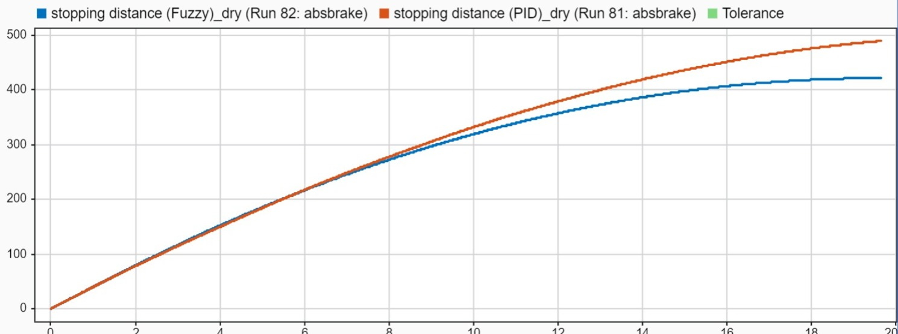 |

**Observation:** On dry asphalt, the FLC tracks the target slip more closely and shows less oscillation than PID. The report also shows a slightly shorter stopping distance with FLC.

#### Wet Asphalt

| Vehicle Speed | Wheel Speed |
| :---: | :---: |
| 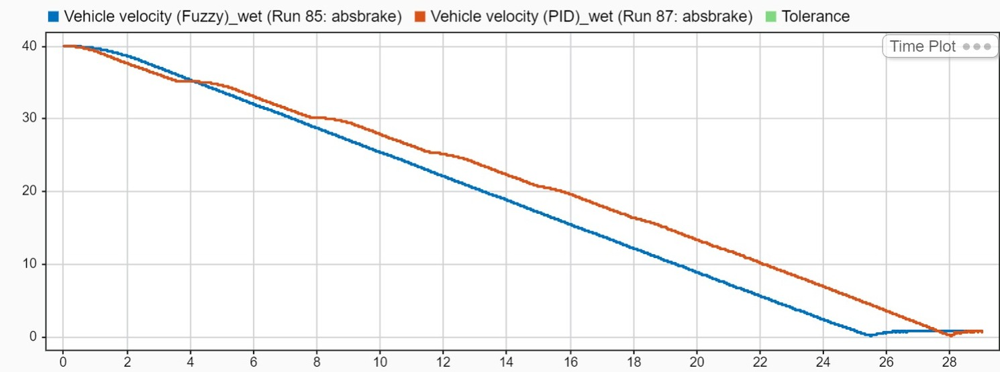 | 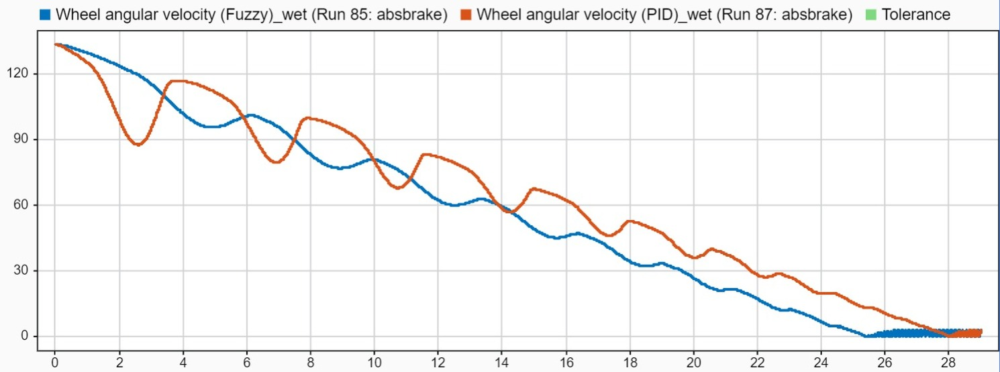 |

| Slip Ratio | Stopping Distance |
| :---: | :---: |
| 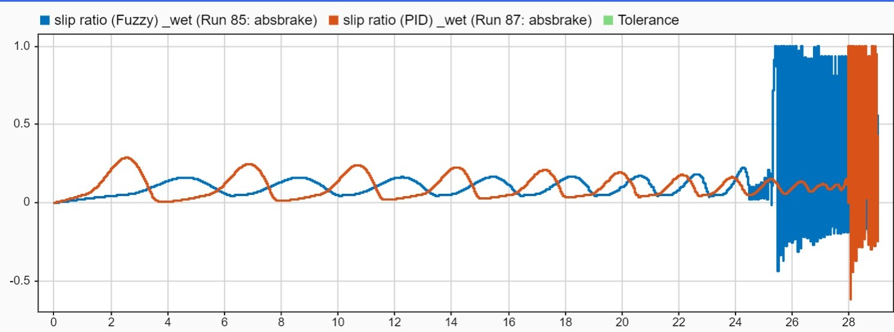 | 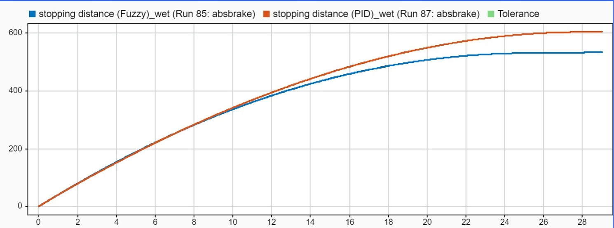 |

**Observation:** The FLC shows smoother wheel-speed behavior and better tracking of the target slip ratio. The overall vehicle-speed performance is similar, with FLC stopping at a slightly shorter distance according to the report.

#### Icy Asphalt

| Vehicle Speed | Wheel Speed |
| :---: | :---: |
| 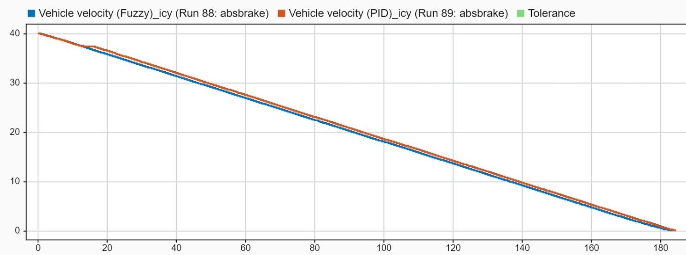 | 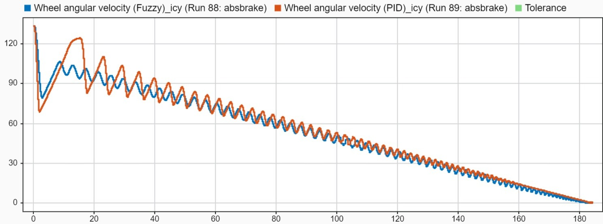 |

| Slip Ratio | Stopping Distance |
| :---: | :---: |
| 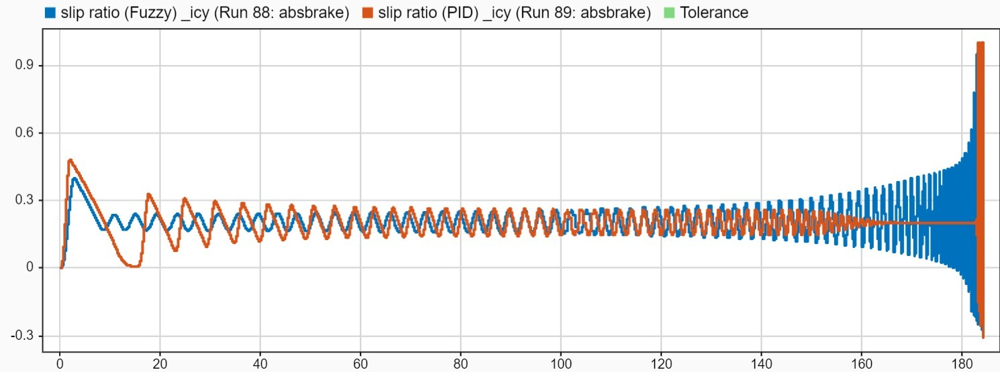 | 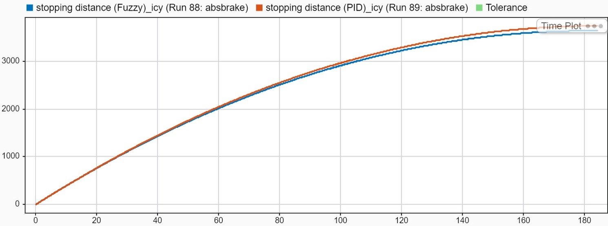 |

**Observation:** Both controllers struggle to keep slip near the target on icy asphalt. FLC oscillations are less aggressive, but overall braking performance is closer to PID than on dry asphalt.

---

### Key Discussion Points

1. **Dry Asphalt**: Maximum performance difference between the two controllers occurs on dry asphalt because the friction coefficient $\mu$ changes sharply with slip. The FLC effectively handles the high non-linearity, resulting in zero chattering and shorter stopping distances.
2. **Wet Asphalt**: Lower friction coefficient magnifies PID tracking error and instability. FLC maintains superior slip control with significantly smoother velocity decay.
3. **Icy Asphalt**: On ice, $\mu$ varies minimally across slip ratios. Consequently, high slip oscillations have less impact on overall deceleration, making PID and Fuzzy performance very close.

---

## Authors & Acknowledgments

* **Authors**: Abdul Karim & Salman AL-KHULAQI

---

## License

This project is open-source and available under the [MIT License](LICENSE).